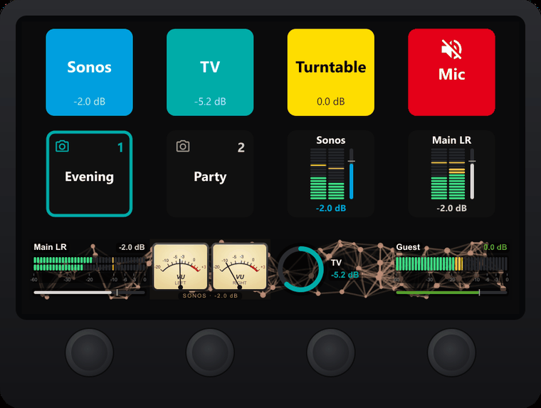

# XR-C — X-Air Controller for Stream Deck

**Your Behringer X-Air mixer on your Stream Deck: faders on dials, mutes on keys, live meters everywhere.**

[](https://github.com/rocklobster42195/streamdeck-xair-controller/releases)
[](https://ko-fi.com/rocklobster42195)
[](LICENSE)



XR-C puts the channels of a **Behringer XR12, XR16, XR18** or **Midas MR18** onto an Elgato Stream Deck. Each channel keeps the name and colour you gave it on the mixer. Dials set levels with a live meter in the display, and keys mute channels, switch mute groups or load snapshots. Anything you change on the mixer or in its app shows up on the deck immediately, and the other way round.

**Status:** alpha. The features below are tried on a real mixer (a Behringer XR12) and against a mixer emulator.

> **Disclaimer:** This is an independent, community-made plugin. It is not affiliated with, endorsed by, or officially connected to Behringer, Midas, Music Tribe or Elgato in any way. "X-Air" is a trademark of Music Tribe.

---

## Contents

- [Highlights](#highlights)
- [Requirements](#requirements)
- [Getting started](#getting-started)
- [Actions](#actions)
- [Meters and display styles](#meters-and-display-styles)
- [A short mixer primer](#a-short-mixer-primer)
- [How XR-C talks to the mixer](#how-xr-c-talks-to-the-mixer)
- [Works with other plugins (deckbus)](#works-with-other-plugins-deckbus)
- [Troubleshooting](#troubleshooting)
- [Planned](#planned)
- [Development](#development)
- [Part of a family](#part-of-a-family)
- [Ideas and feedback](#ideas-and-feedback)
- [Support](#support)
- [Credits and licence](#credits-and-licence)

---

## Highlights

- **Looks like your mixer.** Names and colours come from the mixer's scribble strips and update live when you rename a channel.
- **Live meters** on dials and keys:
  - as LED bars with peak hold and a clip indicator;
  - or as analog VU meters with real needle inertia, for the classic look.

  They follow a channel in mono or stereo, depending on its type.
- **Always in sync.** Moves made on the mixer, in X AIR Edit or in the X AIR app appear on the deck at once.
- **Safe by design:**
  - snapshots load only after a second press (or a long press);
  - sends switch off without losing their level;
  - XR-C never changes anything you didn't operate.
- **Light on the network.** Meters are requested only while a key or dial that shows one is on screen.
- **English and German.**

## Requirements

- An Elgato **Stream Deck** with app version **7.1** or later, on Windows 10+ or macOS 12+. The dial actions need a **Stream Deck +** (or another model with dials).
- A **Behringer X-Air XR12, XR16, XR18** or **Midas MR18**, recent firmware.
- The computer running Stream Deck and the mixer on the **same network**: Wi-Fi or cable, the mixer's own access point or your home network.

## Getting started

1. **Install XR-C.** It isn't released yet; this section will link the download.
2. **Put an XR-C action on your deck**, for example **Fader** on a dial or **Channel** on a key.
3. **Connect the mixer.** Open the action's settings and look at the **Mixer** card at the bottom:
   - press **Search**, and XR-C lists the mixers on your network ("XR12-24-7D-57 [XR12]"). Click yours;
   - or type its IP address and press **Connect**. You find the address in X AIR Edit, or in your router's list of devices.

   The card turns green and shows model, name, address and firmware. Every XR-C action shares this connection, so you set it up once.

4. **Pick a channel.** The list shows the names from your mixer; stereo channels are marked "stereo".

**Over a VPN** the search can't reach the mixer, because broadcasts don't pass through VPN tunnels. Type the address instead. The VPN must route the mixer's network.

## Actions

### Fader *(dial)*

One channel on a dial: its level, mute and meter.

| Input | Effect |
|---|---|
| Rotate | Level, 1 dB per step by default (0.5–6 dB adjustable). Turning up from -∞ starts at -60 dB. |
| Push | Mute / unmute |
| Tap the display | 0 dB (unity) |
| Tap and hold | -∞ (fader all the way down) |

The display shows the channel name, the fader in dB in the channel's colour, and one of four [display styles](#meters-and-display-styles). A muted channel shows **MUTE** in red, and its meter dims. Any strip works: input channels, aux in, FX returns, buses, FX sends, Main LR and DCAs. A linked stereo pair appears once in the list; it moves both channels.

**Name line** (in the settings): the name in white (default), name and dB in the channel's colour, or the whole line as a coloured strip like the scribble strip on the console. An inverted colour stays dark, with frame and text in the colour, as on the console.

### Send *(dial)*

One **send** on a dial: how much of a channel goes to a bus (e.g. a monitor mix) or to an effect (e.g. reverb). The display is headed "Vocals → Monitor".

| Input | Effect |
|---|---|
| Rotate | Send level |
| Push | Send off (-∞) and back on. The level from before comes back, because X-Air mixers have no on/off switch per send. |
| Tap the display | 0 dB |
| Tap and hold | -∞ |

The meter shows the **channel's** level, and the bar underneath shows the **send** level. The send's tap point (PRE, POST…) is shown in small type; see [pre and post](#buses-and-sends).

### Channel *(key)*

One channel on a key. **Press** to mute; **hold** (0.6 s) to reset the peak hold and the clip indicator.

- **Scribble strip** look (default): the key looks like the channel's strip on the mixer.
  - The channel colour fills the key, with the name large and the fader small.
  - Muted: the key turns red with a crossed-out speaker. A red channel also gets stripes, so red alone never means "muted".
  - Muted through a mute group or a DCA: a red frame with "MG" or "DCA" instead.
  - Optionally a thin meter along the bottom edge.
- **Meter** look: LED bars (one for mono, two for stereo) with a peak line, a red clip bar on top and the fader as a slim bar beside it. Its name line can be white, coloured or a strip, like on the Fader dial.

### Mute Group *(key)*

Switches one of the four [mute groups](#mute-groups). Red while the group is active, with the member channels in small type. The mixer has no names for mute groups, so you can give the key a title of your own ("Band" instead of "MG 1").

### Snapshot *(key)*

Loads one of the mixer's 64 [snapshots](#snapshots) and shows its number and name. The snapshot loaded last gets a green frame.

A snapshot changes the whole mix, so by default the first press only **arms** the key (it pulses yellow for 2 seconds) and a second press loads it. You can switch to **Immediately** or **Hold** instead.

## Meters and display styles

The fader is always shown by its **travel**, like the physical fader: -∞ at 0 %, 0 dB at 75 % (a small tick), +10 dB at 100 %. The meter next to it shows the level in dBFS.

Dials offer four styles:

| Style | Shows | For |
|---|---|---|
| **Digital** | LED bars lying flat, peak hold, a dB scale and the fader as a slim bar underneath | Everyday use; the most exact reading |
| **Classic** | Analog VU meters with a cream face and needle, one per side | The look of an old tape machine |
| **Ring** | The fader position as a ring | Just the fader, no meter |
| **Pie** | The fader position as a filled pie | Just the fader, no meter |

**Mono or stereo:** mono channels get one bar or meter. Stereo sources get two: aux in, FX returns, Main LR, and channels or buses you linked as a stereo pair on the mixer.

**Reading the digital meter:**
- **Green** up to -18 dBFS: a healthy level.
- **Yellow** from -18 dBFS: loud.
- **Red** from -6 dBFS: close to the limit.
- The **peak line** stays at the highest recent level for 1.5 seconds.
- The **clip indicator** on the Channel key stays on after the signal hit 0 dBFS, until you hold the key.
- The bar rises at once and falls back smoothly, like a hardware meter.

**Reading the VU meter:** a VU meter shows the *average* loudness, not the peaks. Its needle takes about 300 ms to settle, which is what makes it calm and pleasant to watch. XR-C calibrates **0 VU to -18 dBFS**, the usual studio reference: music that sits around 0 VU is at a good level.

## A short mixer primer

New to digital mixers? These are the terms XR-C uses, in a few lines each.

### Channels and strips

A **channel** is one input: a microphone, a guitar, the stereo output of a TV. On the mixer every channel has a **strip**: its fader, mute button, meter and settings. X-Air mixers also have strips that aren't inputs:

- the **aux in**, a stereo line input;
- the **FX returns**, where the effects come back;
- the **buses** and **FX sends**, see below;
- **Main LR**, the main stereo output;
- the **DCAs**, see below.

XR-C can put any of these on a dial.

### Gain and fader

**Gain** (on the preamp) sets how hard the signal enters the mixer; you set it once, so the input is strong but never clips. The **fader** sets how much of the channel goes into the mix; that's what you change during use, and what XR-C's dials control.

### Decibels and the fader

Levels are measured in **decibels (dB)**:
- **0 dB** on a fader means "unity": the signal passes unchanged.
- The fader goes up to **+10 dB** and down to **-∞** (silence).
- **-6 dB** is about half as loud to a meter, and about **-10 dB** sounds half as loud to the ear.

Meters use **dBFS** ("full scale"): 0 dBFS is the loudest a digital signal can be, so everything below is negative.

### Mute

**Mute** silences a channel without touching its fader, so unmuting brings it back exactly as it was.

### Stereo link

Two neighbouring channels (1-2, 3-4…) or buses can be **linked** into a stereo pair: one fader, one mute, two meters. XR-C treats a linked pair as one stereo channel.

### Buses and sends

A **bus** is an extra mix next to the main one, for example the monitor speaker of a singer, headphones, or a second room like a kitchen. Each channel has a **send** to each bus: an extra "fader" that decides how much of the channel goes into that mix. X-Air mixers have 6 buses.

Where the send picks up the signal is its **tap point**:
- **PRE** (pre-fader): independent of the channel's main fader. Moving the main fader doesn't change the monitor mix. This is typical for monitors.
- **POST** (post-fader): follows the main fader. This is typical for effects, so the reverb gets quieter along with the voice.
- **IN**, **PRE EQ**, **POST EQ**: earlier points in the channel's signal chain.

### Effects: FX sends and returns

X-Air mixers have 4 effect slots (reverb, delay, chorus…). A channel's **FX send** feeds an effect, and the effect's output comes back on an **FX return**, a stereo strip with its own fader. The Send dial controls the FX send; a Fader dial on the FX return controls how loud the effect is overall.

### DCAs

A **DCA** (the name comes from old analog gear) is a fader that controls several channels at once *without* mixing them together. Turn the "Drums" DCA down 3 dB, and every drum channel goes down 3 dB, keeping its balance. Switching a DCA off mutes all its channels. X-Air mixers have 4 DCAs. On the Channel key, a channel muted by its DCA gets a red frame marked "DCA".

### Mute groups

A **mute group** mutes a set of channels with one button, for example "all band instruments" between songs. The channels' own mute buttons stay untouched, so when the group is switched off, each channel comes back as it was. X-Air mixers have 4 mute groups, and you choose the members on the mixer. On the Channel key, a channel muted by a group gets a red frame marked "MG".

### Snapshots

A **snapshot** (also "scene") stores the complete mix: faders, mutes, sends, effects, routing. Loading one sets everything back to that moment. X-Air mixers hold 64. Typical uses: one snapshot per band, per song, or per situation at home ("Evening", "Party", "Movie").

### Scribble strips

On large consoles each channel has a small display, the **scribble strip**, with its name and colour. On X-Air mixers they live in the app. XR-C shows them on your keys and dials.

## How XR-C talks to the mixer

- XR-C speaks **OSC**, the mixer's network protocol, directly over **UDP port 10024**. It doesn't need X AIR Edit, a cloud service or an account.
- It asks the mixer to report changes (renewed every 8 seconds). That's how moves on the mixer reach the deck at once.
- The mixer sends such reports to only a few apps at a time (about four). With many X AIR apps and tablets open at once, one of them may stop getting updates.
- Meters stream at about 20 updates per second, but only while a key or dial showing a meter is visible. Hidden pages cost nothing.
- Keys and dials redraw at most about 15 times per second, and only when something changed, to spare the Stream Deck's USB bandwidth.
- XR-C sends nothing to the internet. Everything stays between your computer and your mixer.

## Works with other plugins (deckbus)

XR-C talks to other Stream Deck plugins on your computer through **deckbus**, a small open bus between plugins. For example, [MA-C (Music Assistant Controller)](https://github.com/rocklobster42195/streamdeck-music-assistant-controller) can let its Panorama move with a channel's level. You don't need to set anything up: when both plugins run, they find each other.

**Offers:**
- whether the mixer is online, with its model and name;
- the meters of every channel, bus, FX and the main mix, with the names from your mixer (a linked stereo pair is one stream). They go out only while another plugin actually shows them. Until then, XR-C doesn't even ask the mixer for them.

**Uses:** nothing yet.

**Only with your permission:** nothing yet. Later, other plugins may ask XR-C to lower a channel for a moment (for example during an announcement). That will need your OK per plugin, and XR-C will always put the level back.

deckbus stays on your computer. It uses local pipes (Windows) or sockets (macOS), plugins must know a key stored in your user profile, and nothing goes over the network. The protocol is open: [deckbus protocol](https://github.com/rocklobster42195/streamdeck-kit/blob/main/docs/deckbus-protocol.md).

## Troubleshooting

**Search finds no mixer:**
- Is the computer on the same network as the mixer?
- A VPN can't pass the search; type the address instead.
- Some firewalls block UDP; allow Stream Deck to use the network.

**"Mixer not answering":**
- Check that the mixer is on and reachable, for example with X AIR Edit or a ping to its address.
- XR-C keeps retrying and reconnects by itself.

**Changes on the mixer don't show up, but the deck still controls it:** too many apps are connected at once (the mixer updates only a few). Close some X AIR apps or tablets.

**The meter stays empty:** DCAs have no meter. And the Ring and Pie styles show only the fader.

**The classic VU needle sits at the right end:** the signal is very hot (above -15 dBFS on average). The VU meter is calibrated for studio levels.

## Planned

- **USB stick player** (XR12/XR16): play jingles or clips from the mixer's USB stick by key, and browse the stick on a dial.
- **Meter bridge:** several channels' meters across the whole touch strip.
- **More controls:** solo, pan, gain, effect parameters, tap tempo.
- **Working with MA-C:** the Panorama effects of MA-C ([Music Assistant Controller](https://github.com/rocklobster42195/streamdeck-music-assistant-controller)) could dance to XR-C's meters, and announcements could lower the music on the mixer.
- **X32 and M32** consoles.

## Development

```bash
npm install
npm run build          # plugin and settings panels
npm run check          # build, tests, lint, manifest validation
npm run sim:meters     # Fader dials against the emulator → sim-out/meters/
npm run sim:keys       # Channel keys in every look and mute state → sim-out/keys/
npm run sim:scenes     # Send dials, Mute Group and Snapshot keys → sim-out/scenes/
npm run sim:bus        # XR-C on deckbus with a fake mixer, 30 s (watch it with the kit's tools/bus-monitor.mjs)
npm run pi:preview     # settings panels in a browser with invented data → http://localhost:5299/fader-dial.html
npm run showcase       # the README's GIF → docs/screenshots/xr-c.gif
npm run icons          # regenerate icons
```

XR-C is built on two packages of its own:
- [`xair-client`](https://github.com/rocklobster42195/xair-client): the X-Air OSC client, with an emulator for tests.
- [`@rocklobster42195/streamdeck-kit`](https://github.com/rocklobster42195/streamdeck-kit): shared Stream Deck building blocks such as meters, gauges and the settings panel kit.

The GIF at the top comes from the real plugin running against the emulator, with invented channel names.

## Part of a family

X-Air Controller is one of a small family of Stream Deck plugins. They are built on the same open foundation, **[streamdeck-kit](https://github.com/rocklobster42195/streamdeck-kit)** (MIT, on npm), so they look and feel the same and share what is worth sharing.

| | Plugin | For | Status |
|---|---|---|---|
|  | [Sonos Controller](https://github.com/rocklobster42195/streamdeck-sonos-controller) | Sonos speakers | on the Marketplace, 0.5.0 in beta |
|  | [Music Assistant Controller](https://github.com/rocklobster42195/streamdeck-music-assistant-controller) | your Music Assistant server and its players | alpha |
|  | [System Audio Controller](https://github.com/rocklobster42195/streamdeck-system-audio-controller) | your computer's sound: volume, apps, microphone | beta |
|  | **X-Air Controller** (this plugin) | Behringer X-Air and Midas mixers | alpha |
|  | [Home Assistant Controller](https://github.com/rocklobster42195/streamdeck-home-assistant-controller) | your smart home, also over MQTT | alpha |

What they have in common:

- **The same look and feel.** Keys and dials are drawn by the same kit: one symbol size, the same colours, errors always in the same place, and a settings window in one style with diagnostics, in English, German and Spanish.
- **One Panorama across plugins.** Dials of different plugins in one row share an effect (particles, a picture, a webcam, …) as if they were one display.
- **They find each other.** Through [deckbus](#works-with-other-plugins-deckbus) the plugins share players and colours without any setup, on your computer only.
- **Reusable.** The kit is open, MIT licensed and on npm as [`@rocklobster42195/streamdeck-kit`](https://www.npmjs.com/package/@rocklobster42195/streamdeck-kit). If you build Stream Deck plugins yourself, take what helps.

## Ideas and feedback

Ideas from outside are very welcome: they show what I stopped seeing on my own deck. Please open an [issue](https://github.com/rocklobster42195/streamdeck-xair-controller/issues/new/choose) with your idea or problem. Small fixes as pull requests are welcome too; for bigger things, please start with an issue. Code that every plugin could use (drawing, effects, the settings window) belongs in [streamdeck-kit](https://github.com/rocklobster42195/streamdeck-kit).

## Support

This plugin started as a tool for my own Stream Deck. It is free and MIT licensed, and everyone is welcome to use it. If you like it, a coffee and a beer are always welcome: **[ko-fi.com/rocklobster42195](https://ko-fi.com/rocklobster42195)**.

## Credits and licence

- Icons: [Material Design Icons](https://pictogrammers.com/library/mdi/) by Pictogrammers.
- Made by Boris Kemper ([Rocklobster](https://github.com/rocklobster42195)).
- Licence: MIT.
